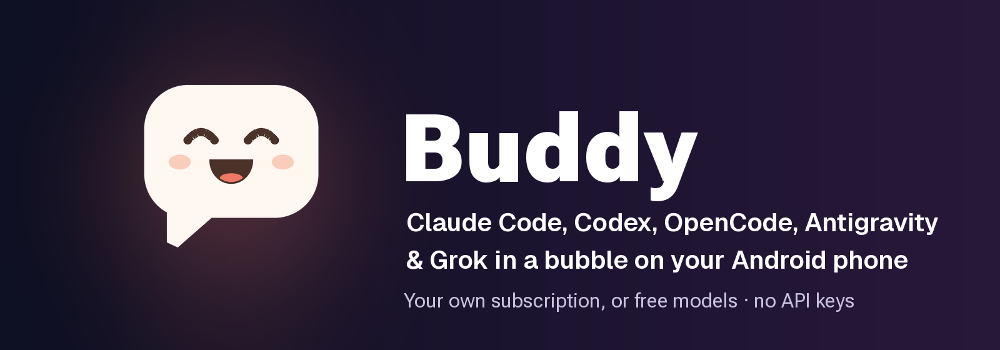

<p align="center">
  
</p>

<p align="center">
  <a href="https://github.com/ghorbelhamdi/buddy-android/releases/latest"></a>
  <a href="https://github.com/ghorbelhamdi/buddy-android/releases"></a>
  
  <a href="https://www.producthunt.com/products/buddy-20"></a>
  <a href="https://glama.ai/mcp/servers/ghorbelhamdi/buddy-android"></a>
  <a href="LICENSE"></a>
</p>

# Buddy

**A floating chat bubble that lets Claude Code, Codex, OpenCode or Antigravity use your Android phone.**

Type or say what you want, like "reply to Sam that I'm running late" or "add a Switch 2 to my Amazon cart". Buddy reads the screen, taps and types to get it done, and asks you before anything is sent, posted, bought or deleted.

It runs inside the app, on your own plan: [Claude Code](https://docs.claude.com/en/docs/claude-code) with your Claude plan, Codex with your ChatGPT plan, Google's [Antigravity CLI](https://antigravity.google) with your Google account, or [OpenCode](https://opencode.ai) with its free models and no account at all. No PC, no adb, no root, no API key.

<p align="center"><a href="#setup"><b>Get it on Google Play</b></a> (closed testing) · <a href="https://github.com/ghorbelhamdi/buddy-android/releases/latest/download/buddy.apk"><b>Download the APK</b></a> · <a href="https://ghorbelhamdi.github.io/buddy-android/">Website</a> · Android 11+, 64-bit</p>

<div align="center">

https://github.com/user-attachments/assets/d07936fc-4788-4ab5-a105-31b3e9aeba4f

<sub>Codex turns on the lights while OpenCode's free model adds a Switch 2 to the Amazon cart (real recordings, waiting sped up)</sub>
</div>

<table>
  <tr>
    <td width="33%" align="center"><br><sub>Chats with any agent</sub></td>
    <td width="33%" align="center"><br><sub>Tool calls fold into one line</sub></td>
    <td width="33%" align="center"><br><sub>Setup guide and themes</sub></td>
  </tr>
</table>

## What it can do

| | |
|---|---|
| **Uses your apps** | Messages, shopping, smart home, settings: anything on screen. Add instructions while it works. |
| **Asks first** | Approve, Deny or Change before anything is sent, posted, bought or deleted. |
| **Shows you how** | "Show me how to turn on dark mode": it points at each step and waits for your tap. |
| **Acts on notifications** | "When a customer asks on WhatsApp, reply with our opening hours", with your OK or a countdown you can stop. |
| **Voice** | Talk to it and have replies read aloud. |
| **Background browser** | Web pages in a browser inside Buddy, without taking over your screen, even while the phone is locked. Watch and use it live in the chat; it marks what you need to do (sign in, a captcha) and never types your passwords. GitHub version. |
| **Builds apps** | In developer mode, "make me a calculator app" builds and installs a real APK on the phone. |
| **Phone tools anywhere** | The same tools as a local MCP server for your own Claude Code, Codex, OpenCode or Antigravity sessions, or over stdio with [mcp-bridge](mcp-bridge) for clients that start servers as commands. |

> **Status: 2.2, early.** It works well day to day but has rough edges. Tested most on a OnePlus 12 (Android 16). Buddy is an independent project, not made by or affiliated with Anthropic, OpenAI or Google.

## How it works

```
Buddy app / bubble ──► Buddy's Linux (Alpine via proot): claude, codex, opencode or agy
        ▲                                                     │
        └──────────── streamed replies ◄──────────────────────┤
                                                              ▼
Buddy accessibility service ◄──── MCP on 127.0.0.1 (phone tools)
```

Buddy is a normal Android app with an accessibility service, the kind of permission screen readers use. The agent runs in a small Linux inside the app and uses Buddy's phone tools (read the screen, tap, type, scroll, open apps) over a local MCP server. No adb or Wireless debugging, and it works without Wi-Fi.

## Setup

You need a 64-bit Android 11+ phone, plus a Claude, ChatGPT or Google account for those agents. OpenCode's free models need no account.

1. **Install Buddy.**
   - **Google Play (recommended):** join the [tester group](https://groups.google.com/g/buddy-testers), [opt in](https://play.google.com/apps/testing/app.buddy.assistant), then install Buddy from Google Play. Every tester helps it get to production.
   - **APK:** [download buddy.apk](https://github.com/ghorbelhamdi/buddy-android/releases/latest/download/buddy.apk) and open it. This version also has developer mode and self-updates.
2. **Follow the setup guide** that opens on first launch: pick your agent, turn on the accessibility service, install and sign in, and try a first task.

**Install blocked or "Restricted setting"?** See [Setup in detail](docs/GUIDE.md#setup-in-detail).

## Updating

Install the new APK over the old one: chats, settings and sign-ins stay (don't uninstall first). You can also ask Buddy to *"update yourself"*, or let [Obtainium](https://obtainium.imranr.dev) do it ([how](docs/GUIDE.md#updating)). The Play version updates through Play.

## Security

An accessibility service is powerful, so please read this.

- **Local only.** The phone tools listen on `127.0.0.1` with a random per-install token.
- **Buddy enforces the approvals, not the agent.** Messaging, shopping and money apps start on a hard limit: Buddy itself stops on buttons like Send, Pay and Delete until you OK them.
- **Prompt injection is the main risk.** A message or web page could try to give the agent orders. On-screen text is treated as content, and the approval card is the backstop, so read it.
- **No passwords.** Buddy never types passwords, codes or payment details; it hands those to you.
- **What leaves the phone:** only what the agent sends to its provider (Anthropic, OpenAI, Google, OpenCode's service or the provider you connected) to answer you.

More in [Security in detail](docs/GUIDE.md#security-in-detail). Found a problem? Please open a private security advisory instead of a public issue.

## FAQ

**What does it cost?** Buddy is free. The agent uses your plan's limits, or nothing at all with Antigravity's free plan or OpenCode's free models.

**iPhone?** No. iOS doesn't let apps operate other apps.

**Which phones?** 64-bit Android 11 or newer. On some brands, set Buddy's battery use to *Unrestricted*.

**Does it need a computer, adb or root?** No.

## Learn more

- [User guide](docs/GUIDE.md): chats, models, voice, notification rules, the bubble, Remote Control, SSH and developer mode
- [Benchmark](benchmark/README.md): which model uses a phone best
- [Privacy policy](docs/PRIVACY.md)

**In the press:** [ProPakistani](https://propakistani.pk/2026/10/12/this-free-android-app-lets-claude-code-use-your-phone/), [The Neutral](https://theneutral.pk/this-free-android-app-lets-ai-control-your-phone-without-a-pc/), [Trendshift](https://trendshift.io/repositories/289557) (October 2026)

## Contributing

Bug reports, ideas and pull requests are welcome: see [CONTRIBUTING.md](CONTRIBUTING.md). If Buddy is useful to you, a ⭐ helps other people find it.

## For developers

```
./gradlew assembleRelease     # Android Studio / Gradle
./build.sh                    # on the phone in Termux, no Gradle → build/buddy-release.apk
```

`build.sh` needs `pkg install openjdk-17 aapt2 d8 apksigner python` and android.jar from platform-36 at `~/android-sdk/android-36/android.jar`. It creates a signing key at `~/.buddy-keys/release.jks` on first run: back it up, since updates must be signed with the same key. Gradle release signing reads `BUDDY_KEYSTORE` and `BUDDY_KEYSTORE_PASSWORD` (optionally `BUDDY_KEY_ALIAS`, `BUDDY_KEY_PASSWORD`). The version lives in `BuildInfo.java`, and the project layout is in [CONTRIBUTING.md](CONTRIBUTING.md#project-layout).

## License

[Apache-2.0](LICENSE). Geist fonts: SIL Open Font License. Icons: Material Symbols (Apache-2.0). Bundled proot (GPL-2.0), talloc (LGPL-3.0) and libandroid-shmem (BSD-3-Clause): see [third_party](third_party/README.md) for licences and source.
